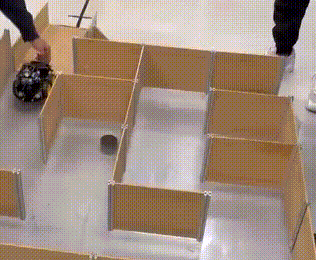

# Autonomous Rover

### Line Following and Maze Navigation on an Arduino-Based Smart Car


-00599C)


<p align="center">
  
  <br>
  <em>GIF of the rover navigating through the maze.</em>
</p>

## Overview

This project programs an **ELEGOO Smart Robot Car Kit V4 (Uno R3)** to navigate two environments autonomously: a black-line course and a walled maze. The rover reads its IR line sensors and ultrasonic distance sensor, then applies control logic to drive its motors in response.

It was developed as the final group project for **MTE502: Microprocessor Systems** at Toronto Metropolitan University (Fall 2025). The challenge was to follow a black line, pause at the end, and then solve a maze without hitting the walls.

## Key Features

- **PID line following** with derivative smoothing and error-based speed reduction for tight corners
- **Pivot recovery** when the tape drifts to the far left or far right of the sensor array
- **Ultrasonic wall detection** with distance averaging across multiple readings
- **Two maze strategies:** a hard-coded turn sequence and an automated wall-reaction algorithm
- **Timed 90-degree turns** with separate left and right calibration

## Programs

All code is in the `Code Solutions` folder.

| Program | Approach |
|---|---|
| Line Following | 5-channel IR array, PID steering, intersection-aware stopping |
| Hard-Coded Maze | Drives to each wall, then performs the next turn in a preset sequence |
| Automated Maze | At each wall, checks left, then right, then performs a U-turn if both are blocked |


## How It Works

### Line Following

The IR sensors are read as five channels and compared against a threshold. A weighted average of the active sensors gives a line position error, which feeds a PID controller that adjusts the left and right motor speeds.

| Parameter | Value |
|---|---|
| Kp | 22.0 |
| Ki | 0.0 |
| Kd | 10.0 |
| Derivative smoothing (alpha) | 0.5 |
| Base / max speed (PWM) | 60 / 100 |
| Sensor threshold | 400 |

Notable behaviors:

- **Derivative smoothing:** an exponential filter on the derivative term stops motor jerks on sharp turns.
- **Dynamic speed:** the base speed drops as the error grows, which reduces overshoot on tight corners.
- **Pivot recovery:** if the tape is detected only on the far left or far right, the rover spins in place until the center sensors re-acquire the line.
- **Line lost:** if no sensor sees the line, the motors stop.


### Maze Navigation: Hard-Coded Solution

The rover drives forward in short pulses, measuring distance while stationary. When it reaches a wall (13 cm), it performs the next turn from a preset sequence and continues. After the last turn it drives onto the exit ramp and stops.

```cpp
const char turnSeq[] = {'L', 'R', 'L', 'L', 'L', 'R', 'R'};
```

### Maze Navigation: Automated Solution

At every wall, the rover decides for itself:

1. Turn left and check the distance. If it is clear (more than 20 cm), move forward.
2. If not, turn to face the right side. If that is clear, move forward.
3. If both sides are blocked, make a U-turn and go back the way it came.


## Hardware

| Component | Description |
|---|---|
| Microcontroller | Arduino Uno R3 |
| Chassis | ELEGOO Smart Robot Car Kit V4 |
| Motors | 4x DC motors with wheels |
| Motor Driver | TB6612 |
| Line Sensing | IR sensor array (read as 5 channels, pins A0 to A4) |
| Distance Sensing | Ultrasonic sensor (the kit mounts it on a servo) |
| Power | <!-- TODO: battery type and voltage --> |

### Pin Configuration

| Function | Arduino Pin |
|---|---|
| IR sensors (R, MR, M, ML, L) | A0, A1, A2, A3, A4 |
| Ultrasonic TRIG / ECHO | 13 / 12 |
| Motor driver STBY | 3 |
| Motor PWM (left / right) | 5 / 6 |
| Motor direction (left / right) | 7 / 8 |

## Development Process

The solution was built over six iterations, each tested on its own before integration.

1. **Basic line following:** drifted and overshot turns because the sensor threshold was too low.
2. **PID line following:** tuned gains, added derivative smoothing, and reduced speed on corners, which gave stable tracking on curves and sharp turns.
3. **Object detection:** drove forward and stopped at a set distance, used to find a safe stopping distance at speed.
4. **Obstacle avoidance:** detected walls in three directions and turned into free space, but got stuck in dead ends.
5. **Outer wall following:** worked in principle but crashed often because of inconsistent turns and distance thresholds.
6. **Final maze logic:** shorter checking intervals and a "go forward, then check left, then right, then U-turn" strategy cut crashes and avoided dead ends.

## Results

- **Line following:** stable on straight lines, curves, and sharp turns after adding PID control, smoothing, and speed adjustment.
- **Maze navigation:** completed the maze in under 30 seconds with one minor collision.
- **Integration:** the line following and maze programs ran as separate sketches and were not merged into one autonomous program, so the full demo run was only partially successful.

## Known Limitations

- **Timed turns drift with battery voltage.** The turn delays had to be recalibrated between runs, and the turning radius was never fully consistent.
- **Programs are not integrated.** Line following and maze solving are separate sketches.
- **The hard-coded solution only works for the preset maze layout.**

## Future Improvements

- [ ] Replace timed turns with encoder-based or gyro-based turning
- [ ] Merge line following and maze navigation into a single state machine
- [ ] Run tests with a fully charged battery, or add voltage compensation
- [ ] Add maze mapping so the rover can avoid revisiting dead ends

## Repository Structure

```
.
├── Code Solutions/   # Line following, hard-coded maze, and automated maze sketches
├── images/           # Photos, diagrams, and demo media
└── README.md
```

## Getting Started

1. Assemble the ELEGOO Smart Car Kit V4 following its instructions.
2. Open the desired sketch from `Code Solutions` in the Arduino IDE.
3. Select **Arduino Uno** as the board and the correct serial port, then upload.
4. Place the rover on the line or at the maze entrance and power it on.
5. Open the Serial Monitor at 9600 baud to view distance readings and turn commands.

> **Tip:** use a fully charged battery and recalibrate `turnDelayLeft` and `turnDelayRight` before each maze run.

## Gallery

| Rover | Line Course | Maze |
|:---:|:---:|:---:|
|  |  |  |

## Team

- Shivam Dave
- Luke D'Souza
- Leo Paternostro
- Osman Asif
